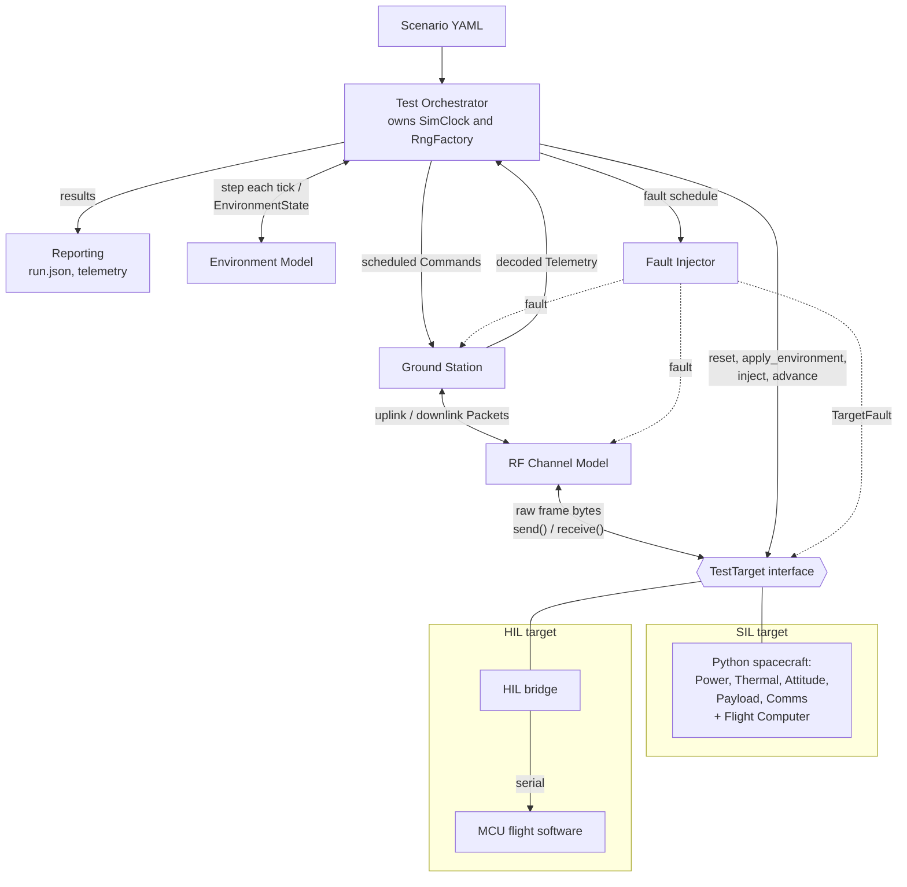

# PocketSat Test Lab

[](https://github.com/solaranoir/pocketsat-testlab/actions/workflows/ci.yml)

A Python Software/Hardware-in-the-Loop (SIL/HIL) test platform for a simulated
spacecraft, a simulated RF channel, and an amateur-radio-style ground station.

## Project goal

Build the **test infrastructure** for a small spacecraft: scenario definition,
orchestration, fault injection, reproducible seeded runs, and reporting. The same
scenario runs unchanged against a Python spacecraft simulation (SIL) or a
microcontroller running flight software (HIL), because the scenario runner only ever
talks to the `TestTarget` interface.

Version 1 will cover SIL and MCU HIL, a YAML scenario DSL, reusable fault injection,
seeded test campaigns, and CI.

Fault injection today: the SIL target implements target-level fault injection
(`forced_reset`, `sensor_freeze`, `transmitter_off`, and `battery_drain`, #60); RF fault
injection (Phase 4) and HIL faults (Phase 7) are pending.

## Status

**Phase 0 (architecture and skeleton) and Phase 1 (virtual spacecraft) are complete**;
Phase 2 (ground station) is next. See [`docs/roadmap.md`](docs/roadmap.md) for every
phase.

Phase 1's milestone, "run a nominal scenario and receive deterministic spacecraft
telemetry", was verified in #65. It delivers:

- **The SIL spacecraft**: power, thermal, attitude, payload, and comms subsystem models
  on a shared snapshot board, with calibrated defaults
  ([`docs/spacecraft.md`](docs/spacecraft.md)).
- **The flight computer**: six modes (BOOT, NOMINAL, SCIENCE, DOWNLINK, SAFE, FAULT),
  automatic SAFE and FAULT entry, boot and RESET, and the controls each mode gives the
  subsystems ([`docs/spacecraft-modes.md`](docs/spacecraft-modes.md)).
- **Commands and telemetry on the wire**: `PING`, `SET_MODE`, `BEGIN_DOWNLINK`,
  `ENTER_SAFE_MODE`, and `RESET` with an ACK or NACK for each; a 26-byte telemetry
  payload at a per-mode cadence; and DATA frames that downlink the stored payload data in
  DOWNLINK passes, within the radio's transmit rate ([`docs/protocol.md`](docs/protocol.md),
  ADR-0009). Shared test vectors in `tests/vectors/` are the contract for the Phase 7
  firmware.
- **`SilTarget`** behind the `TestTarget` interface, with target faults, passing the
  contract suite (`tests/contract/`) and the determinism tests
  (`tests/sil/test_sil_determinism.py`).
- **The nominal scenario and golden telemetry**: one orbit of SCIENCE with a 10-minute
  DOWNLINK pass, checked end to end through `TestTarget`
  (`tests/sil/test_phase1_nominal_spacecraft.py`), and every downlink frame of it kept
  byte for byte in `tests/golden/`, identical on Linux and macOS (ADR-0006).
- **Budgets**: the power, thermal, and data budget
  ([`docs/power-thermal-budget.md`](docs/power-thermal-budget.md)) and the simulation
  performance budget (100 µs per tick averaged over an orbit, 150 µs worst case, on CI
  Linux; [`docs/spacecraft.md`](docs/spacecraft.md#performance-budget-78)).

Run the nominal scenario and the golden telemetry check:

```sh
uv run pytest -m slow tests/sil/test_phase1_nominal_spacecraft.py -s   # one orbit, a few seconds
uv run python tests/sil/_golden.py --check                             # replay the golden captures
```

The scenario is a Python test harness for now (`tests/sil/_nominal_scenario.py`); YAML
scenarios and the orchestrator arrive with the scenario DSL in Phase 5. Regenerating a
golden capture is deliberate and reviewed: see
[`tests/golden/README.md`](tests/golden/README.md).

## Architecture



See [`docs/architecture.md`](docs/architecture.md) for component boundaries, data
flow, and the run lifecycle.

Design decisions are recorded as ADRs in [`docs/adr/`](docs/adr/). The wire format is
described in [`docs/protocol.md`](docs/protocol.md), and the phase plan in
[`docs/roadmap.md`](docs/roadmap.md).

## Development

Requires Python 3.12+ and [uv](https://docs.astral.sh/uv/).

```sh
uv sync
uv run pocketsat --version
uv run ruff check . && uv run ruff format --check . && uv run mypy src && uv run pytest
```

Contributors, human or AI, should read [`AGENTS.md`](AGENTS.md) first.

## Demo

[`scripts/demo_spacecraft.py`](scripts/demo_spacecraft.py) runs the spacecraft subsystem
models (epic #30) together and prints a text report. It takes a few seconds:

```sh
uv run python scripts/demo_spacecraft.py                        # all scenarios
uv run python scripts/demo_spacecraft.py --scenario faults      # one scenario
uv run python scripts/demo_spacecraft.py --orbits 3 --seed 7    # longer nominal run
```

The real power, thermal, attitude, payload, and comms subsystems share a
`SnapshotBoard`, driven by `NominalEnvironment` and a `SimClock`. The nominal orbit
takes its controls from the real flight computer; the other scenarios script them. The
scenarios are:

- `nominal`: an orbit's timeline (sunlight and eclipse, true and estimated SOC, bus
  voltage, temperatures, survival heater, attitude, payload buffer, radio mode and
  transmit draw) and an energy, heater, payload, downlink, comms, and flag summary.
  The flight computer runs SCIENCE, then a DOWNLINK pass 10 minutes before the end of
  each orbit, sending the stored chunks as DATA frames and releasing them once sent
  (#56).
- `detumble`: a high starting rate with attitude control off, then on. Generation
  drops while tumbling, and the payload waits for `STABILIZED`.
- `faults`: `battery_drain` (`extra_load_w`) sets `low_battery` and
  `critical_battery` and stops acquisition; `sensor_freeze` (`frozen_sensors`) holds
  the readings while the truth moves; the `transmitter_off` representation downgrades
  the radio mode from `RX_TX` to `RX_ONLY`, so transmit capacity and draw drop to 0
  while the receiver stays on.
- `determinism`: the same seed gives identical digests, and a new seed with the
  attitude disturbance off changes only the sensor readings.
- `cold`: a permanent cold eclipse where the survival heater never switches off.

## License

[Apache License 2.0](LICENSE)
