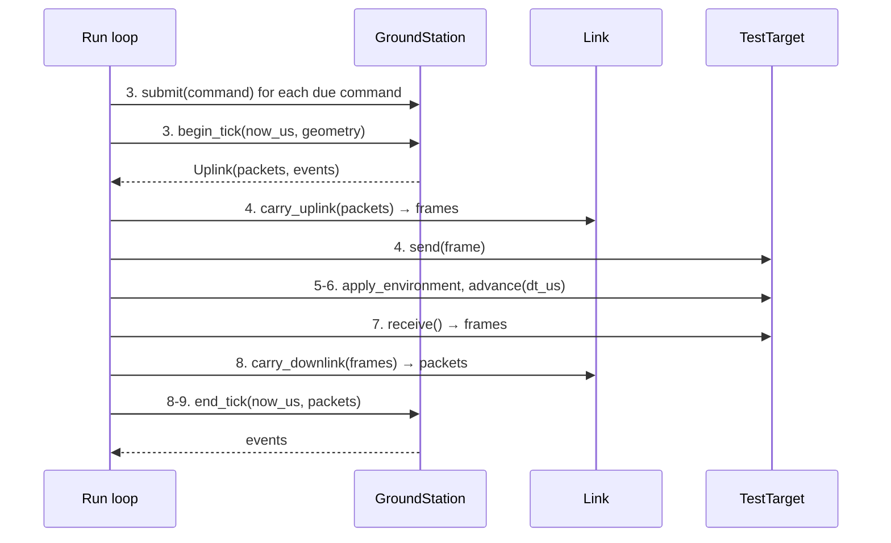

# PocketSat Ground Station

Status: Phase 2 in progress. The framework is in place (#152): the package, the station
configuration, the event types and the per-tick API. Behaviour lands ticket by ticket;
the table at the end lists what each one adds. The design is
[ADR-0010](adr/0010-ground-station-architecture.md) (Accepted).

The ground station is shared infrastructure above the `TestTarget` boundary
(`docs/architecture.md` §3, §4.2). It runs the same against SIL and HIL targets, and
over the Phase 2 ideal link or the Phase 3 RF channel, because it never calls any of
them.

## The station is a pure component

`pocketsat.groundstation.GroundStation` takes simulated time, pass geometry and downlink
packets, and returns uplink packets and events. It never calls the target, the link or a
clock, and it draws no random numbers in Phase 2. The run loop (#167) moves packets
between the station, the link (#153) and the target:

## API

| Call | When | Does |
|---|---|---|
| `GroundStation(config)` | once | Builds a station ready to run, in the state `reset` returns to |
| `reset(rngs)` | start of a run | Returns to the configured initial state at time 0. Phase 4's ground-station faults will request `groundstation.*` streams from `rngs` |
| `submit(command)` | step 3 | Queues a `Command`; returns the `CommandRef` that names it in every later event. Nothing is encoded yet |
| `begin_tick(now_us, geometry)` | steps 3-4, tick start | Pass state (#161), timeouts and retries (#155), then encoding queued commands while the radio may transmit (#154, #164). Returns `Uplink(packets, events)` |
| `end_tick(now_us, downlink)` | steps 8-9, tick end | Decodes each packet in arrival order (#156, #155, #158) and returns the events: per packet, frame-level events first, then the content |
| `telemetry` | any time | Read-only `TelemetryStore` of decoded telemetry (#157) |
| `link_statistics`, `pass_link_statistics` | any time | Downlink `LinkStatistics` since the last reset and for the current pass (#156) |
| `data` | any time | The `DataStore` of payload data received, reassembled by chunk ID, with its `DataStatistics` (#158). Read only |

`now_us` is integer simulated microseconds (ADR-0003) and never goes back:
`begin_tick` gets the tick's start, `end_tick` its end (the time `SilTarget` gives the
flight computer), and the next `begin_tick` starts where the last tick ended. `geometry`
is a `PassGeometry` (`pocketsat.environment.geometry`) or `None` when no geometry model
runs; the station treats it as its pass prediction (ADR-0010 §6).

## Configuration

`StationConfig` is a frozen, validated record, injected at construction like the
spacecraft settings (ADR-0005). Change single values with `dataclasses.replace()`.

| Field | Default | Why |
|---|---|---|
| `callsign` | `N0CALL` | The placeholder callsign amateur software uses, so no real station is named. Never on the wire (ADR-0010 §9) |
| `latitude_deg`, `longitude_deg` | 40.0, -105.0 | A mid-latitude station that sees several passes a day |
| `altitude_km` | 1.6 | Matches that location; validated in -0.5 to 9.0 km |
| `elevation_mask_deg` | 10.0 | Below about 10° passes are long-range and often blocked by terrain. The station's operating limit (AOS/LOS, transmit permission); the link applies the geometric horizon separately (ADR-0010 §5) |
| `uplink_frequency_hz` | 145 850 000 | 2 m amateur-satellite sub-band |
| `downlink_frequency_hz` | 435 500 000 | 70 cm amateur-satellite sub-band |
| `command_timeout_us` | 2 000 000 | 20 ticks at 100 ms. Command to ACK is the same tick at the default tick, a few ticks late for a RESET at short ticks (ADR-0008 §6a) |
| `command_retry_count` | 2 | Retries after the first attempt, 0 to 10. RESET is never retried (below) |
| `identification_interval_us` | 600 000 000 | 10 minutes, the interval amateur rules commonly require |
| `max_uplink_command_count` | 4 | Most COMMAND frames per tick (#154). Each command's 14-byte ACK comes down in the same tick, and the default downlink carries 120 bytes per 100 ms tick, so four ACKs (56 bytes) still leave room for a 36-byte TELEMETRY frame |
| `command_expiry_us` | `None` | How long after its due time an unsent command is dropped as `CommandFailed` (`EXPIRED`) (#154). `None` keeps it queued for the next pass |
| `data_chunk_size_bytes` | 64 | Payload chunk size (#158). Not on the wire: both ends are configured with it (ADR-0009 §6), so it must equal the spacecraft's `PayloadConfig.chunk_size_bytes`, whose default it matches |

`StationConfig.check_tick(tick_us)` rejects a timeout shorter than two ticks, so an
answer in the next tick is never a timeout. This is a provisional bound; #155 states the
full one.

## Commands, references and retries

Each submitted command gets a `CommandRef`, numbered from 0 after each reset and never
sent. Each attempt is a new COMMAND frame with its own uplink sequence number (the
station's uplink counter starts at 0 on reset and wraps `0xFFFF` → `0x0000`), linked to
the command by its `CommandRef` (ADR-0010 §2).

Retries follow a policy per command (#155). `PING`, `SET_MODE`, `ENTER_SAFE_MODE` and
`BEGIN_DOWNLINK` are safe to repeat (ADR-0009 §4). `RESET` is not: the spacecraft
accepts it in every mode, BOOT included, so a retry after a lost ACK reboots it a second
time. A RESET that times out is reported as `CommandFailed` (`NOT_RETRYABLE`) and the
scenario decides.

## Uplink

`submit(command, *, due_us=None)` queues a command; `begin_tick` sends it
(`pocketsat.groundstation.uplink`, #154). In `begin_tick`, after pass state and timeouts:

1. **Expiry.** With `command_expiry_us` set, every queued command still waiting
   `command_expiry_us` after its due time is dropped and reported as `CommandFailed`
   with reason `EXPIRED`. This is checked whether or not the gate is open, so a command
   queued through a whole outage still expires on time.
2. **Gate.** If the transmit gate is closed, nothing is sent and the commands stay
   queued. The gate is a function of simulated time, `transmit_gate(now_us) -> bool`,
   given to the constructor (`GroundStation(config, transmit_gate=...)`). It defaults to
   `always_open` until radio control (#164) supplies the real one, and it must be
   deterministic.
3. **Send.** Due commands (`due_us <= now_us`) are encoded into COMMAND frames
   (`encode_command`, ADR-0009 §3) in order of due time, then submission order, at most
   `max_uplink_command_count` per tick. A command that is not yet due never holds back
   one that is. Each frame takes the next uplink sequence number and gets a
   `CommandSent` event (`retry_count` 0).

`due_us` defaults to the station's current time, the time of its latest `begin_tick` or
`end_tick`, so a command submitted at step 3 goes out in the same tick's `begin_tick`. A
due time in the past is due at once. The uplink sequence starts at 0 on `reset` and
wraps `0xFFFF` → `0x0000`. `Uplink.events` lists expiries first, then one
`CommandSent` per packet in transmission order. Uplink packets carry only the frame;
the link fills any link attributes.

Retries and timeouts are #155: until then a sent command is never sent again.

## Events

Every event is a frozen record whose first field is `time_us`. `StationEvent` is their
union and `EVENT_TYPES` lists them. The station keeps no event history; the run loop
collects the events. The console (#165) and assertions read only events and the
telemetry store, so a new observable is a new event type.

| Event | Emitted by | Fields besides `time_us` |
|---|---|---|
| `Aos` | pass state (#161) | `pass_id`, `azimuth_deg`, `elevation_deg` |
| `Los` | pass state (#161) | `pass_id`, `azimuth_deg`, `elevation_deg`, `max_elevation_deg` |
| `CommandSent` | uplink (#154) | `command_ref`, `command_id`, `sequence`, `retry_count` (0 on the first attempt) |
| `CommandAcked` | ACK correlation (#155) | `command_ref`, `sequence` |
| `CommandNacked` | ACK correlation (#155) | `command_ref`, `sequence`, `reason` (`DecodeReason` or `RejectReason`) |
| `CommandTimedOut` | ACK correlation (#155) | `command_ref`, `retry_count`, `will_retry` |
| `CommandFailed` | ACK correlation (#155), uplink expiry (#154) | `command_ref`, `reason` (`FailureReason`: `RETRIES_EXHAUSTED`, `NOT_RETRYABLE`, `EXPIRED`) |
| `UnmatchedAck` | ACK correlation (#155) | `sequence`, `command_id` |
| `TelemetryReceived` | decoding (#156) | `sequence`, `telemetry` |
| `DataChunkReceived` | DATA (#158) | `sequence`, `chunk_id`, `content_ok`, `duplicate` |
| `FrameRejected` | decoding (#156) | `reason` (`RejectionReason`: sync, length, CRC, type, payload, wrong direction), `frame` |
| `SequenceGap` | decoding (#156) | `sequence` (received), `missing_count`; the expected sequence is `(sequence - missing_count) mod 65536` |
| `SpacecraftRebooted` | decoding (#156) | `sequence`, `boot_count` |
| `RadioStateChanged` | radio control (#164) | `state` (`RadioState`) |
| `StationIdentified` | radio control (#164) | `callsign` |

A COMMAND frame received on the downlink, as `EchoTarget` produces, is a
`FrameRejected` with reason `WRONG_DIRECTION` and its bytes. Frames the link drops are
counted by the link, not the station, which never sees them.

## Downlink

`end_tick` hands each packet, in arrival order, to the `DownlinkDecoder`
(`pocketsat.groundstation.downlink`, #156). Nothing raises for any received bytes.

1. **Frame decoding.** A frame that fails `decode_frame` is `FrameRejected` with reason
   `SYNC`, `LENGTH`, `CRC` or `TYPE`. A valid COMMAND frame is `WRONG_DIRECTION`. Neither
   takes part in sequence tracking: a failed frame's header cannot be trusted, and a
   COMMAND frame is not downlink.
2. **Sequence tracking.** Every valid downlink frame, of any type, is checked against
   the one downlink counter (ADR-0009 §7). With `s` received, `e` expected and
   `d = (s - e) mod 65536`:

   | Case | Read as | Missing |
   |---|---|---|
   | First frame after a station reset | in order | 0 |
   | `d == 0` (includes `0xFFFF` → `0`) | in order | 0 |
   | `s == 0`, `d != 0` | restart (reboot) | 0: the old count's lost frames are unknowable |
   | `0 < d < 32768` | gap (wrap included) | `d` |
   | `d >= 32768` | restart whose first frames were lost | `s` (frames `0 .. s - 1`) |

   A gap emits `SequenceGap` before the frame's content. A wrap that lost exactly the
   frames up to `0xFFFF` is indistinguishable from a reboot and is read as a restart.
3. **Content**, by frame type. TELEMETRY decodes into `TelemetryReceived`, followed by
   `SpacecraftRebooted` when its `boot_count` is higher than the previous telemetry's.
   The reboot is confirmed by the boot count, not the header, so it is reported even if
   the restart itself was hidden by a gap. DATA decodes into a chunk that the
   `DataStore` checks, stores and answers with `DataChunkReceived` (#158, below). ACK
   payloads are decoded and passed to a hook that is a no-op until #155 (ACK/NACK
   correlation). Decoded telemetry likewise goes to a hook that #157 fills with the telemetry store.
   A payload that does not decode for its type is `FrameRejected` with reason
   `PAYLOAD`; its sequence was already tracked, because the CRC vouched for the header.

**Link statistics** (`LinkStatistics`): packets received, rejected (in total and per
reason), frames missing, and sequence restarts. `GroundStation.link_statistics` counts
since the last reset and `pass_link_statistics` since the current pass began. Until the
pass state machine (#161) calls `DownlinkDecoder.start_pass()` at each AOS, the whole
run is one pass.

## DATA

DATA chunks go to the station's `DataStore` (`pocketsat.groundstation.data`, #158),
`GroundStation.data`. Every DATA frame gives one `DataChunkReceived`.

- **Content check.** A chunk's content is `chunk_content(chunk_id, chunk_size)` (#43),
  at the station's `data_chunk_size_bytes`. A chunk that does not match, including one
  of another length, is **corrupted** (`content_ok` false): counted and never stored, so
  a later good copy of that ID is still stored.
- **Stored once.** A good chunk is stored by ID. A chunk whose ID is already stored is a
  **duplicate** (`duplicate` true): counted, and the stored copy kept. A corrupted copy
  of a stored ID is counted as corrupted and also flagged `duplicate`.
- **Order.** Chunks are stored by ID whatever order they arrive in; `chunk_ids()` lists
  them in ID order and `chunk(chunk_id)` returns one.
- **Missing IDs.** Within a downlink session chunk IDs go up by one and are released once
  sent (ADR-0009 §6), so an ID never stored between the lowest and highest stored is
  lost. Missing IDs are reported as `ChunkRange`s (`first_id`..`last_id`), so a loss of
  any size is one entry: for the run, and for the current pass between the lowest and
  highest ID stored in that pass.

**DATA statistics** (`DataStatistics`, `data.statistics` since the last reset and
`data.pass_statistics` for the current pass): chunks received, stored, duplicate and
corrupted; content bytes received and stored; the missing ranges and their count; the
times of the first and last chunk; and the rate, `data_rate_bytes_per_s`: the content
bytes received after the first chunk divided by the time from the first chunk to the
last (`None` until two chunks arrived at different times). The DATA pass begins with the
link statistics' pass (`DownlinkDecoder.start_pass()`, #161); stored chunks are kept
across passes.

Story #146's test (`tests/sil/test_station_story_146.py`) runs ten minutes of SCIENCE
and a DOWNLINK pass against `SilTarget` through the ideal link, with the station sending
the commands, and checks every telemetry frame decoded, every chunk stored once, in
order, verified and none missing, and no frame errors or gaps.

## Determinism

The package is scanned by the determinism guard (`tests/unit/test_determinism_guard.py`,
`GROUNDSTATION_MODULES`): no wall-clock time, no global random, portable arithmetic only
(ADR-0003, ADR-0006).

## What each ticket adds

| Ticket | Adds |
|---|---|
| #152 | This framework: package, `StationConfig`, events, per-tick API (stubs below) |
| #153 | `Link` and `IdealLink` (`pocketsat.link`) |
| #154 | Command queue, uplink sequencing and encoding in `begin_tick` |
| #155 | ACK/NACK correlation, timeouts and the retry policy |
| #156 | Downlink frame decoding, sequence gaps, reboot detection in `end_tick` |
| #157 | The telemetry store and its history |
| #158 | DATA reception and chunk reassembly |
| #161 | AOS/LOS pass state from `geometry` |
| #162, #163 | Doppler tuning and the SNR indicator |
| #164 | Radio control: transmit permission and station identification |
| #165, #166 | Mission console and the `pocketsat` CLI command |
