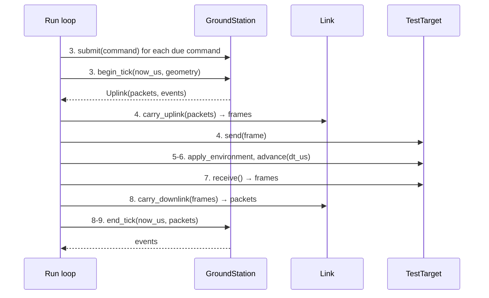

# PocketSat Ground Station

Status: Phase 2 in progress. The framework is in place (#152): the package, the station
configuration, the event types and the per-tick API. Behaviour lands ticket by ticket;
the table at the end lists what each one adds. The design is
[ADR-0010](adr/0010-ground-station-architecture.md) (Accepted).

The ground station is shared infrastructure above the `TestTarget` boundary
(`docs/architecture.md` §3, §4.2). It runs the same against SIL and HIL targets, and
over the Phase 2 ideal link or the Phase 3 RF channel, because it never calls any of
them.

## The station is a pure component

`pocketsat.groundstation.GroundStation` takes simulated time, pass geometry and downlink
packets, and returns uplink packets and events. It never calls the target, the link or a
clock, and it draws no random numbers in Phase 2. The run loop (#167) moves packets
between the station, the link (#153) and the target:



## API

| Call | When | Does |
|---|---|---|
| `GroundStation(config)` | once | Builds a station ready to run, in the state `reset` returns to |
| `reset(rngs)` | start of a run | Returns to the configured initial state at time 0. Phase 4's ground-station faults will request `groundstation.*` streams from `rngs` |
| `submit(command)` | step 3 | Queues a `Command`; returns the `CommandRef` that names it in every later event. Nothing is encoded yet |
| `begin_tick(now_us, geometry)` | steps 3-4, tick start | Pass state (#161), timeouts and retries (#155), then encoding queued commands while the radio may transmit (#154, #164). Returns `Uplink(packets, events)` |
| `end_tick(now_us, downlink)` | steps 8-9, tick end | Decodes each packet in arrival order (#156, #155, #158) and returns the events: per packet, frame-level events first, then the content |
| `telemetry` | any time | Read-only `TelemetryStore` of decoded telemetry (#157) |
| `link_statistics`, `pass_link_statistics` | any time | Downlink `LinkStatistics` since the last reset and for the current pass (#156) |
| `data` | any time | The `DataStore` of payload data received, reassembled by chunk ID, with its `DataStatistics` (#158). Read only |
| `outstanding_commands`, `unmatched_ack_count` | any time | Commands sent and not yet answered, and ACKs that answered none, since the last reset (#155) |

`now_us` is integer simulated microseconds (ADR-0003) and never goes back:
`begin_tick` gets the tick's start, `end_tick` its end (the time `SilTarget` gives the
flight computer), and the next `begin_tick` starts where the last tick ended. `geometry`
is a `PassGeometry` (`pocketsat.environment.geometry`) or `None` when no geometry model
runs; the station treats it as its pass prediction (ADR-0010 §6).

## Configuration

`StationConfig` is a frozen, validated record, injected at construction like the
spacecraft settings (ADR-0005). Change single values with `dataclasses.replace()`.

| Field | Default | Why |
|---|---|---|
| `callsign` | `N0CALL` | The placeholder callsign amateur software uses, so no real station is named. Never on the wire (ADR-0010 §9) |
| `latitude_deg`, `longitude_deg` | 40.0, -105.0 | A mid-latitude station that sees several passes a day |
| `altitude_km` | 1.6 | Matches that location; validated in -0.5 to 9.0 km |
| `elevation_mask_deg` | 10.0 | Below about 10° passes are long-range and often blocked by terrain. The station's operating limit (AOS/LOS, transmit permission); the link applies the geometric horizon separately (ADR-0010 §5) |
| `uplink_frequency_hz` | 145 850 000 | 2 m amateur-satellite sub-band |
| `downlink_frequency_hz` | 435 500 000 | 70 cm amateur-satellite sub-band |
| `command_timeout_us` | 2 000 000 | 20 ticks at 100 ms. Command to ACK is the same tick at the default tick, a few ticks late for a RESET at short ticks (ADR-0008 §6a) |
| `command_retry_count` | 2 | Retries after the first attempt, 0 to 10. RESET is never retried (below) |
| `identification_interval_us` | 600 000 000 | 10 minutes, the interval amateur rules commonly require |
| `max_uplink_command_count` | 4 | Most COMMAND frames per tick (#154). Each command's 14-byte ACK comes down in the same tick, and the default downlink carries 120 bytes per 100 ms tick, so four ACKs (56 bytes) still leave room for a 36-byte TELEMETRY frame |
| `command_expiry_us` | `None` | How long after its due time an unsent command is dropped as `CommandFailed` (`EXPIRED`) (#154). `None` keeps it queued for the next pass |
| `data_chunk_size_bytes` | 64 | Payload chunk size (#158). Not on the wire: both ends are configured with it (ADR-0009 §6), so it must equal the spacecraft's `PayloadConfig.chunk_size_bytes`, whose default it matches |

`StationConfig.check_tick(tick_us)` rejects a timeout shorter than the longest
legitimate answer (`max_answer_latency_us`, see [Command outcomes](#command-outcomes)),
so a command answered as late as the protocol allows never times out.

## Commands, references and retries

Each submitted command gets a `CommandRef`, numbered from 0 after each reset and never
sent. Each attempt is a new COMMAND frame with its own uplink sequence number (the
station's uplink counter starts at 0 on reset and wraps `0xFFFF` → `0x0000`), linked to
the command by its `CommandRef` (ADR-0010 §2).

Retries follow a policy per command (#155). `PING`, `SET_MODE`, `ENTER_SAFE_MODE` and
`BEGIN_DOWNLINK` are safe to repeat (ADR-0009 §4). `RESET` is not: the spacecraft
accepts it in every mode, BOOT included, so a retry after a lost ACK reboots it a second
time. A RESET that times out is reported as `CommandFailed` (`NOT_RETRYABLE`) and the
scenario decides.

## Uplink

`submit(command, *, due_us=None)` queues a command; `begin_tick` sends it
(`pocketsat.groundstation.uplink`, #154). In `begin_tick`, after pass state and timeouts:

1. **Expiry.** With `command_expiry_us` set, every queued command still waiting
   `command_expiry_us` after its due time is dropped and reported as `CommandFailed`
   with reason `EXPIRED`. This is checked whether or not the gate is open, so a command
   queued through a whole outage still expires on time.
2. **Gate.** If the transmit gate is closed, nothing is sent and the commands stay
   queued. The gate is a function of simulated time, `transmit_gate(now_us) -> bool`,
   given to the constructor (`GroundStation(config, transmit_gate=...)`). It defaults to
   `always_open` until radio control (#164) supplies the real one, and it must be
   deterministic.
3. **Send.** Due commands (`due_us <= now_us`) are encoded into COMMAND frames
   (`encode_command`, ADR-0009 §3) in order of due time, then submission order, at most
   `max_uplink_command_count` per tick. A command that is not yet due never holds back
   one that is. Each frame takes the next uplink sequence number and gets a
   `CommandSent` event (`retry_count` 0).

`due_us` defaults to the station's current time, the time of its latest `begin_tick` or
`end_tick`, so a command submitted at step 3 goes out in the same tick's `begin_tick`. A
due time in the past is due at once. The uplink sequence starts at 0 on `reset` and
wraps `0xFFFF` → `0x0000`. `Uplink.events` lists expiries first, then one
`CommandSent` per packet in transmission order. Uplink packets carry only the frame;
the link fills any link attributes.

Retries are queued by ACK correlation (below) with the attempt's `retry_count`, and
then go through the same expiry, gate and per-tick limit.

## Command outcomes

`pocketsat.groundstation.commands` (#155) closes the loop on every command sent. Every
command ends in exactly one of `CommandAcked`, `CommandNacked` or `CommandFailed`;
`outstanding_commands` lists those still waiting.

- **Correlation.** Each decoded ACK/NACK (`decode_ack`, #156) answers the attempt whose
  uplink sequence it names, if it also echoes that attempt's command ID (ADR-0009 §4).
  The first answer resolves the command: `CommandAcked`, or `CommandNacked` with the
  reason as a `DecodeReason` or `RejectReason` member (reported by name). The event
  follows the ACK frame's frame-level events in `end_tick`.
- **Late answers.** A command's earlier attempts stay matchable until it is resolved: an
  ACK for an attempt that timed out still answers the command, since the spacecraft did
  execute it. If the retry is still queued (gate closed), it is cancelled.
- **Unmatched answers.** An ACK for an unknown sequence, with a mismatched command ID,
  or for a command already resolved (a duplicate, or an answer after the command
  failed) is an `UnmatchedAck` event and counted in `unmatched_ack_count`. Never an
  error.
- **Timeouts.** An attempt sent in `begin_tick` at `t` times out in the first
  `begin_tick` at or after `t + command_timeout_us` with no answer decoded.
  `end_tick` runs before the next `begin_tick`, so an answer decoded at exactly the
  timeout is not a timeout. Only a command's latest attempt can time out.
- **Retries** (ADR-0010 §2). A timed-out command gets `CommandTimedOut` with
  `will_retry`. A retry is queued due at the timeout, so with the gate open it goes out
  in the same `begin_tick`, as a new COMMAND frame with a new uplink sequence and the
  next `retry_count`. After `command_retry_count` retries the command fails with
  `RETRIES_EXHAUSTED`. `RESET` is never retried (`NON_RETRYABLE_COMMANDS`): it fails
  with `NOT_RETRYABLE` after its first timeout. A retry that expires in the queue fails
  with `EXPIRED` (#154) and its command is forgotten.
- **Order.** `begin_tick` returns timeouts (and failures) first, in command reference
  order, then the uplink queue's expiries and `CommandSent` events.

**The timeout bound.** `max_answer_latency_us(tick_us, downlink_rate_bytes_per_s=1200)`
is the longest a legitimate answer takes from `begin_tick` to `end_tick`, and
`StationConfig.check_tick` requires `command_timeout_us` to be at least that:

- A command sent at `t` reaches the flight computer in the tick starting at `t`. In a
  whole-frame tick its answer comes down in the same tick and is decoded at `t + tick`
  (ADR-0004, "command → ACK, same tick").
- In streaming ticks the answer can wait behind the rest of a frame in transmission (at
  most 77 bytes), up to 8 held ACK/NACK frames, and its own 14 bytes: 203 bytes
  (ADR-0008 §5), plus one byte for the fraction of a byte the tick capacity carries.
  That airtime, rounded up to whole ticks and never less than one tick, is the bound.
- A RESET's deferred reboot (ADR-0008 §6a) waits for its ACK, so it adds nothing.

| Tick | Bound at 1200 bytes/s |
|---|---|
| 100 ms (default) | 200 ms (2 ticks; the worst case needs 170 ms of airtime) |
| 30 ms | 180 ms (6 ticks) |
| 2 s | 2 s (1 tick) |

The default timeout, 2 s, satisfies every tick up to 2 s. An ACK suppressed because a
ninth is due while eight are held, or lost while the transmitter is off, is a timeout:
the protocol never delivers it.

## Events

Every event is a frozen record whose first field is `time_us`. `StationEvent` is their
union and `EVENT_TYPES` lists them. The station keeps no event history; the run loop
collects the events. The console (#165) and assertions read only events and the
telemetry store, so a new observable is a new event type.

| Event | Emitted by | Fields besides `time_us` |
|---|---|---|
| `Aos` | pass state (#161) | `pass_id`, `azimuth_deg`, `elevation_deg` |
| `Los` | pass state (#161) | `pass_id`, `azimuth_deg`, `elevation_deg`, `max_elevation_deg` |
| `CommandSent` | uplink (#154) | `command_ref`, `command_id`, `sequence`, `retry_count` (0 on the first attempt) |
| `CommandAcked` | ACK correlation (#155) | `command_ref`, `sequence` |
| `CommandNacked` | ACK correlation (#155) | `command_ref`, `sequence`, `reason` (`DecodeReason` or `RejectReason`) |
| `CommandTimedOut` | ACK correlation (#155) | `command_ref`, `retry_count`, `will_retry` |
| `CommandFailed` | ACK correlation (#155), uplink expiry (#154) | `command_ref`, `reason` (`FailureReason`: `RETRIES_EXHAUSTED`, `NOT_RETRYABLE`, `EXPIRED`) |
| `UnmatchedAck` | ACK correlation (#155) | `sequence`, `command_id` |
| `TelemetryReceived` | decoding (#156) | `sequence`, `telemetry`, `snr_db` (the packet's SNR indicator, #163; `None` without geometry) |
| `DataChunkReceived` | DATA (#158) | `sequence`, `chunk_id`, `content_ok`, `duplicate`, `snr_db` (as for `TelemetryReceived`) |
| `FrameRejected` | decoding (#156) | `reason` (`RejectionReason`: sync, length, CRC, type, payload, wrong direction), `frame` |
| `SequenceGap` | decoding (#156) | `sequence` (received), `missing_count`; the expected sequence is `(sequence - missing_count) mod 65536` |
| `SpacecraftRebooted` | decoding (#156) | `sequence`, `boot_count` |
| `RadioStateChanged` | radio control (#164) | `state` (`RadioState`) |
| `StationIdentified` | radio control (#164) | `callsign` |

A COMMAND frame received on the downlink, as `EchoTarget` produces, is a
`FrameRejected` with reason `WRONG_DIRECTION` and its bytes. Frames the link drops are
counted by the link, not the station, which never sees them.

## Downlink

`end_tick` hands each packet, in arrival order, to the `DownlinkDecoder`
(`pocketsat.groundstation.downlink`, #156). Nothing raises for any received bytes.

1. **Frame decoding.** A frame that fails `decode_frame` is `FrameRejected` with reason
   `SYNC`, `LENGTH`, `CRC` or `TYPE`. A valid COMMAND frame is `WRONG_DIRECTION`. Neither
   takes part in sequence tracking: a failed frame's header cannot be trusted, and a
   COMMAND frame is not downlink.
2. **Sequence tracking.** Every valid downlink frame, of any type, is checked against
   the one downlink counter (ADR-0009 §7). With `s` received, `e` expected and
   `d = (s - e) mod 65536`:

   | Case | Read as | Missing |
   |---|---|---|
   | First frame after a station reset | in order | 0 |
   | `d == 0` (includes `0xFFFF` → `0`) | in order | 0 |
   | `s == 0`, `d != 0` | restart (reboot) | 0: the old count's lost frames are unknowable |
   | `0 < d < 32768` | gap (wrap included) | `d` |
   | `d >= 32768` | restart whose first frames were lost | `s` (frames `0 .. s - 1`) |

   A gap emits `SequenceGap` before the frame's content. A wrap that lost exactly the
   frames up to `0xFFFF` is indistinguishable from a reboot and is read as a restart.
3. **Content**, by frame type. TELEMETRY decodes into `TelemetryReceived`, followed by
   `SpacecraftRebooted` when its `boot_count` is higher than the previous telemetry's.
   The reboot is confirmed by the boot count, not the header, so it is reported even if
   the restart itself was hidden by a gap. Each ACK/NACK is correlated with its
   command, and its outcome event follows (#155, "Command outcomes"). DATA decodes into
   a chunk that the `DataStore` checks, stores and answers with `DataChunkReceived`
   (#158, below). Decoded telemetry is also stored in the telemetry store (#157, below).
   A payload that does not decode for its type is `FrameRejected` with reason
   `PAYLOAD`; its sequence was already tracked, because the CRC vouched for the header.

**Link statistics** (`LinkStatistics`): packets received, rejected (in total and per
reason), frames missing, and sequence restarts. `GroundStation.link_statistics` counts
since the last reset and `pass_link_statistics` since the current pass began: the pass
state machine (#161, "Pass state" below) calls `DownlinkDecoder.start_pass()` at each
AOS. A station never given geometry stays in one pass for the whole run.

## Telemetry store

`GroundStation.telemetry` is a `TelemetryStore` (`pocketsat.groundstation.telemetry`,
#157). The downlink decoder appends one `TelemetryRecord` per decoded TELEMETRY frame;
everyone else only reads it, and `reset` empties it.

- **Record:** the decoded `Telemetry`, `time_us` (receive time: the end of the tick,
  integer µs), `sequence` (the frame's downlink sequence) and `pass_id` (0 before the
  first AOS, then the pass number: the pass state machine, #161, calls
  `DownlinkDecoder.start_pass()` at each AOS).
- **Queries:** `latest`, `latest_value(name)`, `window(start_us, end_us)` (half-open,
  receive time), `pass_ids` and `by_pass(pass_id)`, `history`, iteration and `len`.
- **Engineering units:** `Telemetry` already holds each value in its unit at wire
  resolution. `TELEMETRY_QUANTITIES` is the one table of units and resolutions, one row
  per wire field in payload order, and a test checks it against `docs/protocol.md`
  ("Layout and mapping"): `bus_v` in V (0.001), `soc` as a fraction (0.001),
  temperatures in °C (0.01), `pointing_error_deg` in ° (0.01), counters as is.
  `record.value(name)` returns a value, `record.state_name(name)` the name of a mode or
  state (for example `"NOMINAL"`), and `record.flag_names` the flags set, in bit order.
- **Retention:** at most `StationConfig.telemetry_retention_count` records (default
  20 000: about 5.5 hours of continuous reception at the default 1 s telemetry cadence,
  or several days of passes, in about 10 MB). When full, the oldest record is dropped and counted in
  `dropped_count`; queries see only retained records.

## Pass state

`begin_tick` first updates the pass state from `geometry` against
`StationConfig.elevation_mask_deg` (`pocketsat.groundstation.passes`, #161), so this
tick's AOS or LOS comes before the tick's uplink events.

- **AOS** is the first tick whose geometry is at or above the mask: `Aos` with the pass
  number (from 1 after each reset), azimuth and elevation. The decoder's per-pass link
  statistics restart (`DownlinkDecoder.start_pass()`), so `pass_link_statistics` counts
  from AOS to the next AOS.
- **LOS** is the first tick below the mask: `Los` with the pass number, azimuth,
  elevation, and the pass's maximum elevation (the highest sample of the pass).
- **`pass_state`** (`PassState`): `in_pass`, `pass_id` (the current pass, or the last
  one; 0 before the first AOS) and the maximum elevation so far in the current pass.
- **Sampling.** The geometry is sampled at each tick's start, so AOS and LOS are within
  one tick of the true crossing, and the maximum elevation is at most the true peak and
  within the elevation change of half a tick of it (2.2e-5° measured over a day at
  100 ms; 0.031° at a 10 s tick).
- **No hysteresis and no minimum pass duration.** Neither ADR-0010 nor ADR-0011 calls
  for one: the geometry is deterministic and noise-free, so it crosses the mask once
  each way, and a pass that grazes the mask for one tick is a real pass. If Phase 4's
  tracking-error faults make the station's elevation chatter around the mask,
  hysteresis belongs with them.
- **No geometry** (`None`) leaves the state unchanged and emits nothing: a station
  never given geometry is never in a pass, and the whole run is one pass for the link
  statistics.
- **The mask is policy, not physics** (ADR-0010 §5). The link delivers frames above the
  geometric horizon (0°), so between the horizon and the mask frames still arrive while
  the station is not in a pass; radio control (#164) stops transmission below the mask.

Story #147's test (`tests/sil/test_pass_state_story.py`) checks one day of the default
orbit and station (#160): AOS and LOS within one tick of the predicted crossings
(`OrbitGeometry.next_pass`), maximum elevations matching, and, with the mask at 0° so
that passes and link visibility coincide, frames delivered only during passes. The fast
suite runs the day at a 10 s tick; a slow test repeats the AOS/LOS check at 100 ms.

## DATA

DATA chunks go to the station's `DataStore` (`pocketsat.groundstation.data`, #158),
`GroundStation.data`. Every DATA frame gives one `DataChunkReceived`.

- **Content check.** A chunk's content is `chunk_content(chunk_id, chunk_size)` (#43),
  at the station's `data_chunk_size_bytes`. A chunk that does not match, including one
  of another length, is **corrupted** (`content_ok` false): counted and never stored, so
  a later good copy of that ID is still stored.
- **Stored once.** A good chunk is stored by ID. A chunk whose ID is already stored is a
  **duplicate** (`duplicate` true): counted, and the stored copy kept. A corrupted copy
  of a stored ID is counted as corrupted and also flagged `duplicate`.
- **Order.** Chunks are stored by ID whatever order they arrive in; `chunk_ids()` lists
  them in ID order and `chunk(chunk_id)` returns one.
- **Missing IDs.** Within a downlink session chunk IDs go up by one and are released once
  sent (ADR-0009 §6), so an ID never stored between the lowest and highest stored is
  lost. Missing IDs are reported as `ChunkRange`s (`first_id`..`last_id`), so a loss of
  any size is one entry: for the run, and for the current pass between the lowest and
  highest ID stored in that pass.

**DATA statistics** (`DataStatistics`, `data.statistics` since the last reset and
`data.pass_statistics` for the current pass): chunks received, stored, duplicate and
corrupted; content bytes received and stored; the missing ranges and their count; the
times of the first and last chunk; and the rate, `data_rate_bytes_per_s`: the content
bytes received after the first chunk divided by the time from the first chunk to the
last (`None` until two chunks arrived at different times). The DATA pass begins with the
link statistics' pass (`DownlinkDecoder.start_pass()`, #161); stored chunks are kept
across passes.

Story #146's test (`tests/sil/test_station_story_146.py`) runs ten minutes of SCIENCE
and a DOWNLINK pass against `SilTarget` through the ideal link, with the station sending
the commands, and checks every telemetry frame decoded, every chunk stored once, in
order, verified and none missing, and no frame errors or gaps.

## SNR indicator

The link attaches a signal-to-noise ratio to every downlink packet it delivers with
geometry (`Packet.snr_db`, #163), and the station copies it onto the `TelemetryReceived`
and `DataChunkReceived` events of that packet, so the console and assertions see how
strong the signal was for each frame. It is an indicator only: **no packet is dropped
for a low SNR** in Phase 2. Phase 3's RF channel maps SNR to loss behind the same `Link`
protocol (ADR-0010 §5). Uplink frames carry no SNR. Without geometry `snr_db` is `None`.

**Where it lives.** `pocketsat.link_budget.LinkBudget`, beside `pocketsat.link`. The
budget describes the radio path (the spacecraft's transmitter, both antennas, the
station's receiver), so it belongs to the link, not to `StationConfig`: the link does
not depend on the station (ADR-0010 §5), and on HIL it cannot read the spacecraft's
settings across the `TestTarget` boundary. `IdealLink(link_budget=...)` takes one and
defaults to `DEFAULT_LINK_BUDGET`; Phase 3's channel (`pocketsat.rf`) reuses it rather
than introducing the `rf` package early. Change a value with `dataclasses.replace()`.

**The budget** (ADR-0011 §6), all in decibels:

```
SNR = P_tx + G_tx + G_rx - FSPL(d) - L - N
FSPL(d) = 20 log₁₀(4π d f / c)
N = -174 dBm/Hz + 10 log₁₀(B) + NF
```

Only the range `d` changes from tick to tick. Everything else, including
`20 log₁₀(4π · 1 km · f / c)`, `10 log₁₀(B)` and `P_tx` in dBm, is folded into one
constant when the budget is built, so `snr_db(range_km)` is that constant minus
`20 log₁₀(d / 1 km)`: one `portable_db` call (about 1 µs), made once per tick that
delivers downlink frames, whatever their number. Decibels come from the portable,
`frexp`-based `portable_db` (ADR-0006 as amended by ADR-0011 §6), so values are
byte-identical on every platform; the tests pin them exactly. Ranges below 1 km
(`MIN_RANGE_KM`, only reachable with a hand-built `PassGeometry`) are evaluated at 1 km,
where the free-space formula already makes little sense.

**Defaults**: a typical amateur UHF small-satellite downlink, the kind of 1 W, 9600
bit/s 70 cm CubeSat beacon an amateur station with a tracked Yagi receives.

| Field | Default | Why |
|---|---|---|
| `frequency_hz` | 435 500 000 | The station's default `downlink_frequency_hz`, in the 70 cm amateur-satellite sub-band. A test keeps the two defaults equal; a scenario that changes one changes the other |
| `tx_power_w` | 1.0 (30 dBm) | CubeSat UHF transceivers typically transmit 0.5 to 2 W, limited by the bus power budget |
| `tx_antenna_gain_db` | 0.0 dBi | A deployable monopole or dipole on a small satellite is close to omnidirectional (about 0 to 2 dBi); the spacecraft is not pointed at the station |
| `rx_antenna_gain_db` | 12.0 dBi | A circularly polarised 70 cm crossed Yagi on an azimuth-elevation rotator, the common amateur satellite antenna (about 10 to 16 dBic depending on length) |
| `losses_db` | 8.0 | 3 dB polarisation mismatch (a linearly polarised spacecraft antenna into a circular station antenna, which also absorbs Faraday rotation), about 2 dB of feed line and connectors at 435 MHz, about 3 dB for the spacecraft antenna pattern and tumbling (attitude toward the station is not modelled). Atmospheric absorption at UHF (under 0.5 dB) is folded in |
| `bandwidth_hz` | 15 000 | The IF bandwidth of a receiver for 9600 bit/s G3RUH FSK, the usual amateur satellite data mode at that rate; the spacecraft downlink is 1200 bytes/s (9600 bit/s) |
| `noise_figure_db` | 3.0 | An effective system noise figure: a mast-mounted preamplifier (about 0.5 to 1 dB) plus the feed-line loss before the receiver and the antenna noise temperature (sky and warm ground in the beam at low elevation) |

The thermal noise density is the conventional -174 dBm/Hz (kT₀ at 290 K is -173.98);
the speed of light is exact (299 792 458 m/s).

**Typical values.** With the defaults, the noise floor is -129.2 dBm and:

| Range | Where | SNR |
|---|---|---|
| 380 km | overhead (zenith of the default 380 km orbit) | 26.4 dB |
| 460 km | the default orbit's first pass, 54° peak | 24.8 dB |
| 1 000 km | about 18° elevation | 18.0 dB |
| 1 400 km | about 10° elevation (the default mask) | 15.1 dB |
| 2 230 km | the geometric horizon | 11.0 dB |

So the SNR rises by about 14 dB from the horizon to the peak of a high pass and falls
again as the spacecraft sets, the shape Phase 3's loss model needs ("telemetry quality
naturally improves and deteriorates over a simulated LEO pass", `docs/roadmap.md`). The
numbers are the budget's, not a real mission's; scenarios that need a marginal link
lower `tx_power_w` or raise `losses_db`.

**Accuracy.** `snr_db` is within 1e-10 dB of the same budget evaluated with
`math.log10` (measured: 3.6e-14 dB over 1 to 5000 km), and the free-space loss is within
0.01 dB of the textbook `20 log₁₀(d/km) + 20 log₁₀(f/MHz) + 32.45`. Story test
`tests/sil/test_snr_story.py` checks that over the default orbit's first pass the SNR
rises strictly to the peak and falls strictly after it, falls strictly with range, and
pins its values; and that against `SilTarget` every telemetry frame of a 60° pass
arrives, the weakest included, carrying the SNR of its tick.

## Determinism

The package is scanned by the determinism guard (`tests/unit/test_determinism_guard.py`,
`GROUNDSTATION_MODULES`): no wall-clock time, no global random, portable arithmetic only
(ADR-0003, ADR-0006).

## What each ticket adds

| Ticket | Adds |
|---|---|
| #152 | This framework: package, `StationConfig`, events, per-tick API (stubs below) |
| #153 | `Link` and `IdealLink` (`pocketsat.link`) |
| #154 | Command queue, uplink sequencing and encoding in `begin_tick` |
| #155 | ACK/NACK correlation, timeouts and the retry policy |
| #156 | Downlink frame decoding, sequence gaps, reboot detection in `end_tick` |
| #157 | The telemetry store and its history |
| #158 | DATA reception and chunk reassembly |
| #161 | AOS/LOS pass state from `geometry` |
| #162, #163 | Doppler tuning and the SNR indicator |
| #164 | Radio control: transmit permission and station identification |
| #165, #166 | Mission console and the `pocketsat` CLI command |
